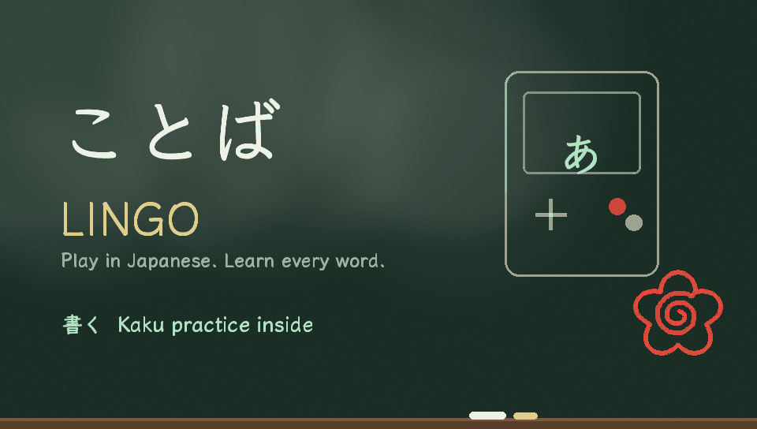

# Lingo for PS Vita

Play Japanese games and learn the words as you go, fully offline. Game Boy, Game Boy Advance, Famicom, Super Famicom, Mega Drive, PC Engine, PlayStation, Saturn, WonderSwan, Neo Geo Pocket, Neo Geo, MSX, Virtual Boy and Pokémon mini.

Lingo is [mGBA](https://mgba.io)'s Vita port plus a libretro front end for the other consoles, with these added:

- **A study panel for every game.** The game sits on the left. When someone talks, their line appears on the right, split into words, with furigana over any kanji. Tap a word for its dictionary entry and what form it's in (たべなかった ← negative past, with a short grammar note). **Breakdown** lists the line word by word. Star words to keep them.
- **Live text reading that learns each game.** Lingo reads text straight from the game's memory. It knows Pokémon's text (Ruby/Sapphire/Emerald/FireRed/LeafGreen, and Red/Green/Blue/Yellow/Gold/Silver/Crystal), reads Shift-JIS (most CD games), and works the rest out by itself while you play. If it can't, tap **Teach** and type one line you can see.
- **Voiced lines.** On PlayStation, Saturn, PC Engine CD and Mega CD the panel can replay the line you just heard, slow it down without changing the pitch, or turn it into text with offline speech recognition (whisper.cpp).
- **Kaku practice.** Write hiragana, katakana and 79 everyday kanji on the touchscreen, with every stroke checked. Reading quizzes with look-alike traps, and spaced review of the words you starred.
- **Lessons.** 14 short classes on one idea each, plus 24 units of grammar notes with 115 drills where every wrong answer explains itself.
- **Your game's own Pokémon.** Tap a Pokémon's name in Ruby/Sapphire/Emerald/FireRed/LeafGreen dialogue and the word card shows its sprite, read from your own cartridge dump.
- **Checkpoints.** When you save after 20 minutes or 15 new words, a 5-question test on the words you met in that game. Get 4 right to carry on. **Strict** mode means turning tests off takes passing one.
- **Play comforts.** Zipped games, each emulator's own settings, rewind (hold the rear touchpad), auto frame skip, save states.
- **Starter games and box art.** A shelf of beginner-friendly picks. Box art comes from libretro's thumbnail server when on Wi-Fi; otherwise Lingo keeps a frame from your own play.



## Install

1. Download `Lingo.vpk` from the latest [release](../../releases).
2. Install it with VitaShell.
3. Put your own cartridge and disc dumps on `ux0:` (or send them from your phone: **From phone** shows a QR code). No games are included.

BIOS files go in `ux0:data/lingo/system/`. The console picker says which ones each console needs.

## Starter games

| Level | Game | System | Text |
| --- | --- | --- | --- |
| Start here | ポケットモンスター ルビー・サファイア / エメラルド / ファイアレッド・リーフグリーン | GBA | Kana only, read by the panel |
| Start here | ドラゴンクエスト, ポートピア連続殺人事件 | Famicom | Kana only |
| Next step | ポケットモンスター 金・銀 | GBC | Kana only, read by the panel |
| Next step | MOTHER 1+2, 聖剣伝説 | GBA, GB | Mostly kana |
| Stretch | MOTHER 3, ファイナルファンタジーVI, スターオーシャン | GBA, SFC | Kana and some kanji |
| Stretch | ときめきメモリアル, うる星やつら | Saturn, PC Engine CD | Voiced, with kanji |

## How text reading works

Games keep the line they are printing in memory as numbers that stand for characters in their own font. Lingo needs that mapping (a "table"):

- **Built in:** Pokémon Gen 3 (its text window and printer), and Pokémon Gen 1/2, whose layout comes from the pret disassemblies.
- **Shift-JIS:** many CD-era games store text in the standard encoding, kanji included.
- **Found automatically:** while dialogue prints, Lingo watches which memory changes and tries the usual font layouts (kana in あいうえお order, at every offset, as bytes or as 16-bit tile numbers, with ゛ marks either built in or drawn above the letter). It keeps the one whose text reads like Japanese, judged by how often each kana follows another in real Japanese.
- **Taught:** type a line you can see. Lingo finds it by relative search: letters keep their order in the font, so "code minus position in あいうえお" is the same for every letter.

Tables are saved in `ux0:data/lingo/tables/` as ordinary `.tbl` files, the format ROM translators use, so you can also drop one in (or send it from your phone). A game that draws its text as pictures, or keeps it compressed, won't read; use **Look up** there. The teach screen can save a **Debug snapshot** of the game's memory for bug reports.

## Where things are saved

| File | What |
| --- | --- |
| `ux0:data/lingo/saved-words.tsv` | Starred words with meaning and the line they came from. Imports straight into Anki. |
| `ux0:data/lingo/review.bin` | Kaku review schedule |
| `ux0:data/lingo/tables/` | Each game's character table |
| `ux0:data/lingo/saves/`, `states/`, `options/` | Saves, save states and emulator settings for the libretro consoles |
| `ux0:data/lingo/models/` | Optional bigger speech model (whisper.cpp `.bin`); the largest one there is used |
| `ux0:data/lingo/shots/` | One picture per game, for the game browser |
| `ux0:data/mGBA/` | Game saves and settings, shared with regular mGBA |

## Building

GitHub Actions builds everything on every push to `main`: it installs VitaSDK, builds the dictionary, runs the host tests, builds each libretro core at a pinned commit (`retro/cores.txt`), applies `patches/` to a pinned mGBA commit, links the front end with every core and whisper.cpp, and publishes `Lingo.vpk` as a release. See `ci/`.

```
src/          Lingo and Kaku (copied into mGBA's src/platform/psp2): panel, text reading, fonts, Kaku, lessons
retro/        the libretro front end: options, rewind, zip, voice capture, speech recognition
patches/      the changes to mGBA's Vita port
tools/        dictionary, kana statistics, Shift-JIS table, Kaku data and art generators
tests/        host tests: text reading, tokenizer, stroke matcher, ROM reader, checkpoints, front end, upload
data/kaku/    Kaku's stroke and kanji data
```

Run the main tests on a PC:

```
python3 tools/build_dict.py jamdict.db lingo.dic
R="src/psp2-lingo-reader.c src/psp2-lingo-bigram.c src/psp2-lingo-sjis.c"
gcc -O2 -o test_lingo tests/test_lingo.c src/psp2-lingo-text.c src/psp2-lingo-dict.c $R -lm && ./test_lingo lingo.dic
gcc -O2 -o test_reader tests/test_reader.c src/psp2-lingo-text.c $R -lm && ./test_reader
gcc -O2 -o test_frontend tests/test_frontend.c retro/retro-zip.c retro/retro-options.c retro/retro-rewind.c retro/retro-voice.c -lz -lm && ./test_frontend
```

## Credits

See [LICENSES.txt](LICENSES.txt): mGBA (MPL 2.0), the libretro cores (each under its own licence), JMdict and KANJIDIC (EDRDG, CC BY-SA 4.0), KanjiVG (CC BY-SA 3.0), Klee One and M PLUS Rounded 1c (OFL), whisper.cpp and the Whisper model (MIT), stroke matching after Hanzi Writer (MIT). Lingo and Kaku by Troy Stokoe.
